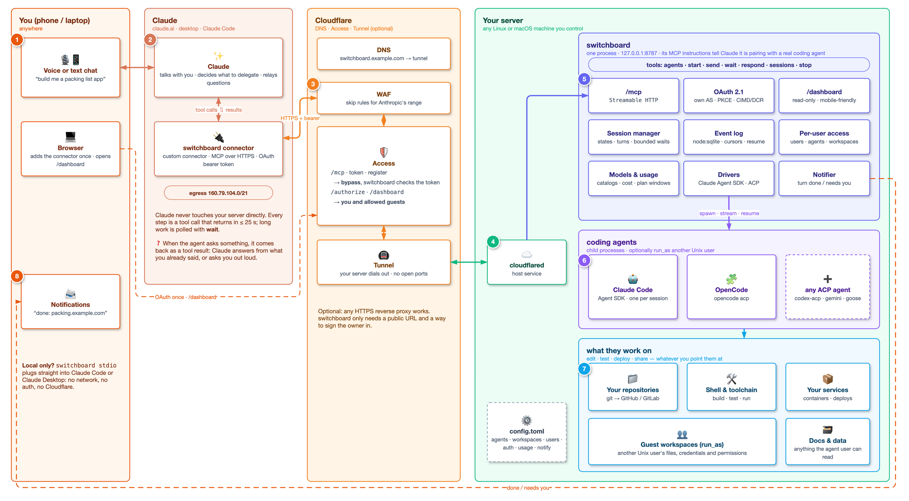
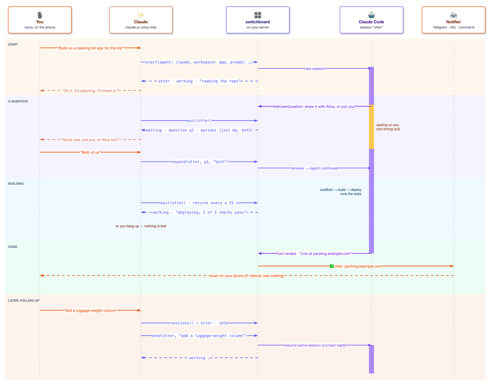

# switchboard

**An MCP server that turns coding agents into something you can delegate to by talking.** Start, steer, answer and resume [Claude Code](https://code.claude.com) or any [Agent Client Protocol](https://agentclientprotocol.com) agent (OpenCode, Codex, Gemini CLI, ...) from any MCP client, including claude.ai on your phone, by voice.

You talk to Claude. Claude hands the work to a real coding agent on a machine you control (for example a home server or a Raspberry Pi), relays the agent's questions back to you, and you get a ping when it is done.



## Why

Regular Claude, in the app or by voice, is a good place to think out loud, but it cannot touch your code. Coding agents can, but they live in a terminal on your machine. The goal: say "build me a packing list app", walk away, and have a real agent do it, asking you the one question it needs to ask, while you are in the car.

Existing options did not cover that:

- **Terminal scrapers and remote-session bridges** drive tmux or an undocumented API. They can start work, but they cannot answer an agent's questions or approvals.
- **Phone apps for one agent** are tied to one vendor and one client.
- **Long blocking calls** break on flaky mobile and voice connections, which cut tool calls off after a short time.

switchboard is the missing control plane: a small MCP server whose tools map to how you would talk about the work, whose calls always return quickly, and whose sessions survive restarts and hang-ups. Research and decisions are in [docs/NOTES.md](docs/NOTES.md) and [docs/design/research](docs/design/research).

## How it works



**Sessions.** Each `start` creates a session: a live agent process in a workspace (a directory you list in the config), named by a short word like "otter". A session is in one of seven states: `starting`, `working`, `waiting` (the agent asked a question or needs approval), `idle` (turn finished, process warm), `parked` (process gone, context kept), `failed` and `closed`. See the [lifecycle diagram](docs/design/diagrams/4-lifecycle.png). Idle sessions park after `idle_park_after` (30 minutes) and `send` resumes them with their context; if all `max_live_sessions` slots are busy, the oldest idle one is parked to make room. Only one turn runs at a time per session.

**Bounded waits.** No tool call blocks longer than `max_wait` (25 s by default); `start`, `send` and `respond` return within about 10 s. Long work is followed with `wait`, which takes a cursor and returns the activity since then, or returns early when a question appears or the turn ends. Hang up mid-build and nothing is lost.

**Questions and approvals.** When the agent asks something (Claude Code's `AskUserQuestion`, or a permission request), the session goes to `waiting` and the request comes back through MCP as structured data with its options. The state holds until someone answers. Claude answers from context or asks you, and passes your words to `respond` ("blue", "2", "allow", "deny", "always").

**Drivers.** Two drivers behind one small interface, producing the same normalized events:

- `claude` drives Claude Code through the official [Agent SDK](https://www.npmjs.com/package/@anthropic-ai/claude-agent-sdk), the most direct way to answer its questions and approvals.
- `acp` drives any [ACP](https://agentclientprotocol.com) agent by command (`opencode acp`, `codex-acp`, `gemini`, ...). Adding one is a config entry.

A `fake` driver exists for tests. Agents can optionally run as another Unix user (`run_as`).

**Storage.** State lives in SQLite (`node:sqlite`, no native dependencies) under `state_dir`: sessions, an event log with cursors, OAuth grants, usage. After a restart sessions come back `parked`; only the turn that was in flight is lost.

**Notifications.** When a turn ends, fails, or the agent needs you, and no client is already waiting, switchboard sends a message through Telegram, ntfy or a command you provide. A question nobody answers triggers a reminder after `nag_after` (10 minutes).

**Auth.** Over stdio there is no auth. Over HTTP switchboard is its own OAuth 2.1 authorization server (PKCE, CIMD and DCR, RFC 9728 / 8414 / 8707), so claude.ai connects as a normal custom connector. The one human step, `/authorize`, is delegated to Cloudflare Access (see [Remote](#remote-claudeai-as-the-client)). The [inside diagram](docs/design/diagrams/3-inside.png) shows the layers.

## Tools

| Tool | What it does |
| --- | --- |
| `agents` | configured agents (with their model catalogs) and workspaces, with descriptions, plus a usage hint |
| `start` | new session on a task (optional `agent`, `workspace`, `model`, `title`); returns within ~10 s with its state |
| `send` | follow-up in a session (resumes parked ones) |
| `wait` | progress since a cursor: activity, a pending question, or the reply |
| `respond` | answer a question or approval in the user's words ("blue", "2", "allow") |
| `sessions` | everything, one line each, optionally filtered by state |
| `stop` | `interrupt` the current turn or `close` the session |

The server's MCP instructions tell the client it is pairing with a live agent, not filling in a form: delegate whole tasks, give short natural updates while waiting (8 to 10 s waits in voice), answer the agent's questions itself only when you already told it the answer, otherwise ask you and pass your answer to `respond`, report the outcome when a turn ends, and use `stop` only when asked. The dashboard shows the exact text.

## Quick start (local, Claude Code or Claude Desktop)

```sh
git clone https://github.com/jeffclimbsbikes/switchboard && cd switchboard
npm ci && npm run build
mkdir -p ~/.config/switchboard && cp switchboard.example.toml ~/.config/switchboard/config.toml
$EDITOR ~/.config/switchboard/config.toml     # set a workspace
node dist/cli.js check
claude mcp add switchboard -- node "$PWD/dist/cli.js" stdio
```

Node 22.13+ is required. `switchboard check` confirms the agent executables and workspaces exist. The config path comes from `--config`, `$SWITCHBOARD_CONFIG` or `~/.config/switchboard/config.toml`. Commands: `serve` (HTTP), `stdio`, `check`, and `grants` (`--revoke` signs every client out).

## Configuration

[switchboard.example.toml](switchboard.example.toml) is a commented starting point. Every key:

| Key | Meaning |
| --- | --- |
| `listen` | `host:port`, default `127.0.0.1:8787` |
| `public_url` | public HTTPS URL; required for OAuth (anything but `auth = none`) |
| `state_dir` | default `~/.local/state/switchboard` |
| `max_wait` | longest any tool call blocks, default `25s` (`ms`, `s`, `m`, `h`) |
| `idle_park_after` | idle time before a session's process exits, default `30m` |
| `max_live_sessions` | concurrent agent processes, default 4 |
| `[agents.<id>]` | `driver = "claude"`, `"acp"` or `"fake"`; see below |
| `[workspaces]` | `id = "path"` or `id = { path, description, default }` |
| `[auth]` | `login = "none"`, `"cloudflare-access"` (`team`, `aud`, `allow`) or `"dev"` (`email`) |
| `[users."email"]` | per-user `agents`, `workspaces`, `notify_chat` |
| `[usage.ollama]`, `[usage.claude]` | optional usage pollers |
| `[notify]` | `telegram = { token_env, chat }`, `ntfy = { url }`, `command`, `nag_after` |

Agent keys: every agent takes `description` (max 300 characters), `models` and `default`. `claude` agents also take `executable` (defaults to the SDK's bundled or PATH `claude`), `model`, `permission_mode` (`default`, `acceptEdits`, `plan`, `bypassPermissions`, `dontAsk`, `auto`; default `default`), `append_system_prompt` and `run_as`. `acp` agents take `command` (required), `env`, `model` and `run_as`. Without `[auth]` the login is `none`.

### Agents, workspaces and descriptions

Give every agent and workspace a short `description` (max 300 characters) so
the client can pick by what each is for. It is optional; the `agents` tool
lists them and the client falls back to the defaults.

```toml
[agents.claude]
driver = "claude"
description = "Strongest model; best for hard or open-ended work."

[workspaces]
site = { path = "~/src/site", description = "My website", default = true }
scratch = "~/scratch"          # the plain path form still works
```

### Models

Give an agent a `models` catalog so the client can choose a model per session
with the cost in view. Every field except `id` is optional:

```toml
[agents.opencode]
driver = "acp"
command = ["opencode", "acp"]
models = [
  { id = "ollama-cloud/kimi-k3.1-pro", label = "Kimi K3.1 Pro", description = "Strong and cheap.", input_price = 0.6, output_price = 2.5, default = true },
  { id = "ollama-cloud/glm-5.3", notes = "Fast for small edits." },
]
```

- `id` is what the agent itself expects: `provider/model` for OpenCode, `opus`
  or `sonnet` for Claude Code.
- Prices are USD per million tokens, list prices for comparison only; the
  Models tab shows "price not published" when they are omitted.
- At most one model is `default`. The agent's own top-level `model` wins when
  it is set; the catalog default only applies when `model` is unset.
- With a catalog, `start({ model })` must be one of its ids, otherwise the
  error lists the options. Without a catalog the model string is passed
  through as before.
- The `agents` tool lists each agent's models, one per line, and the structured
  result carries the whole catalog. `start`'s `model` is "model id from the
  agents tool for the chosen agent".
- Claude Code gets the model as the SDK `model` option. ACP agents get it
  through the agent's model config option (`session/set_config_option`); if
  the agent does not offer that id, the session records a non-fatal error
  instead of silently running another model.

### Usage

The dashboard has a **Usage** tab (and a **Models** tab for the catalog).

- **Cost.** Drivers report `costUsd` and token counts on each turn (Claude Code
  from the result message, ACP agents from `usage_update` cost when they send
  one). switchboard keeps per-session totals in its database plus a small
  per-turn table for the today / 7 days figures. For Claude this is
  API-equivalent cost on a subscription, not a bill.
- **Claude plan windows.** Claude Code's `rate_limit_event` messages (5-hour,
  7-day, 7-day Opus, ...) are stored process-wide with utilization, status and
  reset time, and survive restarts.
- **Optional pollers** (both off unless configured, both fail soft):

```toml
[usage.ollama]
api_key_env = "OLLAMA_API_KEY"   # every 10 min and on demand, cached

[usage.claude]
probe = true                     # EXPERIMENTAL
```

`[usage.ollama]` reads `https://ollama.com/api/me` (only the `Plan` field is
kept; email, name and ids are dropped) and `https://ollama.com/api/usage`
(daily request counts for 7 days). Both endpoints are undocumented and may
change; the UI says so. Ollama's quota percentage is not available through
the API, so the tab links to ollama.com/settings.

`[usage.claude] probe = true` fills the plan windows when no live
`rate_limit_event` arrived in the last 15 minutes. It opens a short-lived SDK
query with the first claude agent that has no `run_as`, calls the SDK's
experimental usage request and closes it. It never sends a prompt, so it
spends no tokens. It depends on an SDK method named
`usage_EXPERIMENTAL_MAY_CHANGE_DO_NOT_RELY_ON_THIS_API_YET`; any error is
logged and ignored.

The `agents` tool ends with a one-line hint when something is known, for
example `Usage: Claude plan: 5-hour 34%, 7-day 61% (resets Tue); Ollama: Pro,
412 requests this week`, so the client can steer toward a cheaper agent.
Restricted users get the hint only for the providers their own agents use, and
the dashboard shows them only their own sessions' cost.

## Remote: claude.ai as the client

Run `switchboard serve` behind HTTPS and add `https://<host>/mcp` as a custom connector in claude.ai (Settings, Connectors). The recommended setup is a Cloudflare Tunnel (your server dials out, no open ports) with two Access applications:

| Host / path | Access policy | Why |
| --- | --- | --- |
| `<host>/authorize` and `<host>/dashboard` | allow your email (and any guests) | the human steps; switchboard verifies the Access JWT |
| `<host>` (everything else) | bypass | claude.ai's servers call `/mcp`, `/token`, discovery; switchboard checks its own bearer tokens |

Give the first application a more specific path so it wins over the host-wide bypass, and check with `curl` from outside your network. If you use a WAF, skip it for Anthropic's published egress range (160.79.104.0/21). Then set `[auth] login = "cloudflare-access"` with your team name, the AUD tag of the Access application, and the allowed emails:

```toml
public_url = "https://switchboard.example.com"

[auth]
login = "cloudflare-access"
team = "your-team"          # your-team.cloudflareaccess.com
aud = "..."                 # AUD tag of the /authorize application
allow = ["you@example.com"]
```

Cloudflare's built-in managed OAuth does not work with claude.ai today, which is why switchboard runs its own. See the [design site](docs/design/site/index.html) for the full flow and diagrams (OAuth sequence, routing, example Terraform). Any reverse proxy that gives you HTTPS and a way to sign the owner in can replace Cloudflare.

## Dashboard

`GET /dashboard` is a read-only mission-control page (no build step, no
external assets) that works on a phone and can be saved to the home screen. It
shows the live KPIs, every configured agent and workspace, sessions grouped by
state with their pending questions, a per-session event timeline, the exact MCP
tool contract and instructions a client sees, connected clients, and a config
summary without secrets. It polls `/dashboard/api/state` every 3 s;
`/dashboard/api/sessions/<name>?since=<seq>` pages one session's event log
(500 max; without `since` you get the newest events).

Auth follows `[auth] login`: `none` and `dev` are open on loopback;
`cloudflare-access` verifies `Cf-Access-Jwt-Assertion` like `/authorize`, so add
`/dashboard` to the Access application that covers `/authorize`. Users listed
under `[users]` see only their own sessions, agents and workspaces, and no
connected clients.

## Multiple people (users and run_as guests)

By default everyone who can sign in is the admin: all agents, all workspaces,
all sessions. List someone under `users` (keyed by the email they sign in with)
to restrict them. They only see the agents and workspaces you list (omit a list
for "all"), the first listed one is their default, and they only see and act on
sessions they started. Someone else's session looks exactly like a missing one.
Emails not listed stay unrestricted, and so do stdio and `auth = "none"`.

```toml
[users."alice@example.com"]
agents = ["alice"]
workspaces = ["alice-site"]
notify_chat = "123456789"     # her Telegram chat; needs [notify.telegram] for the bot token
```

To give a guest a less-privileged agent, run it as another Unix user with `run_as`
on a `claude` or `acp` agent:

```toml
[agents.alice]
driver = "claude"
run_as = "alice"
```

switchboard then starts the agent with `sudo -n -u alice -H`, so it needs a
sudoers rule such as `switchboard ALL=(alice) NOPASSWD: ALL`. The target user
must be able to execute the agent binary and read the workspace. Only `PATH`,
`CLAUDE_*`, `ANTHROPIC_*` and `SWITCHBOARD_*` variables (plus an acp agent's
configured `env`) are passed through; the agent gets her `HOME`, her
credentials, and her permissions, not yours.

## Security model

switchboard runs coding agents with whatever permissions you configure; with `bypassPermissions`, anyone who can call it can run code as that user. So:

- Remote access always goes through OAuth with an email allowlist; `auth = "none"` and `"dev"` refuse to listen beyond loopback.
- Tokens are stored hashed, and refresh tokens rotate with reuse detection.
- The Access bypass on the host only exposes switchboard's own token check; `/authorize` and `/dashboard` verify the Cloudflare Access JWT.
- `[users]` restricts what a signed-in person can see and start, but it is not a sandbox: it is bookkeeping inside one process. For real isolation give a guest a `run_as` agent, so their agent runs as a separate Unix user with its own files and credentials.
- `run_as` needs a sudoers rule for the switchboard user; only `PATH`, `CLAUDE_*`, `ANTHROPIC_*` and `SWITCHBOARD_*` variables are passed through.
- Run switchboard as a user whose blast radius you accept. It has no built-in sandbox for the agents themselves.

## Development

```sh
npm run check            # biome + tsc + vitest (no network, no secrets)
SWITCHBOARD_LIVE=1 npx vitest run test/live   # real claude (haiku) + opencode handshake
```

Every outside dependency has a stand-in in `test/fixtures`: a fake `claude` CLI speaking its stream-json control protocol, a fake ACP agent, a local JWKS for Cloudflare Access. One driver contract suite (`test/contract/driver-contract.ts`) runs against every driver. See the [testing diagram](docs/design/diagrams/7-testing.png).

## Design docs

- [Design site](docs/design/site/index.html): open locally; diagrams are draw.io files with the source embedded (`docs/design/diagrams`, regenerate with the `d*_*.py` scripts and the `drawio` CLI).
- [docs/NOTES.md](docs/NOTES.md): requirements and the decisions log.
- [docs/design/research](docs/design/research): prior art, agent protocols, auth, CLI probes.

## License

MIT
